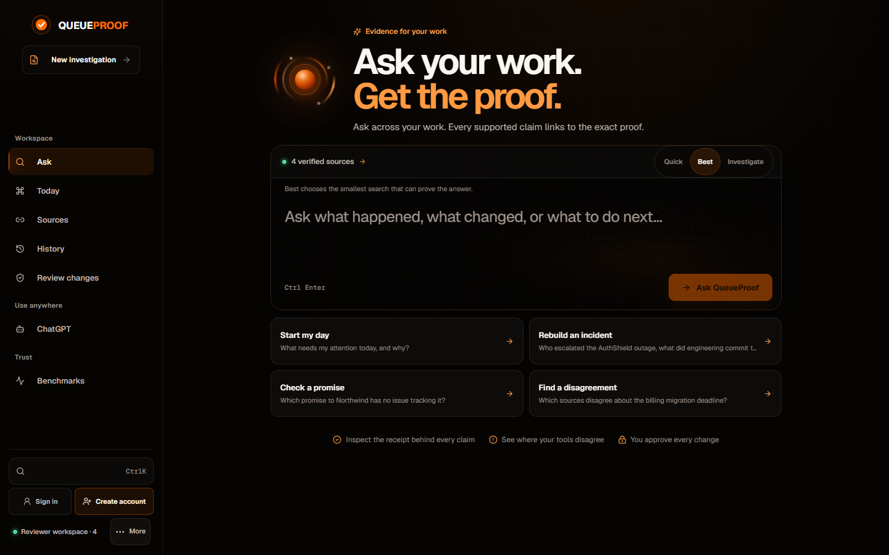
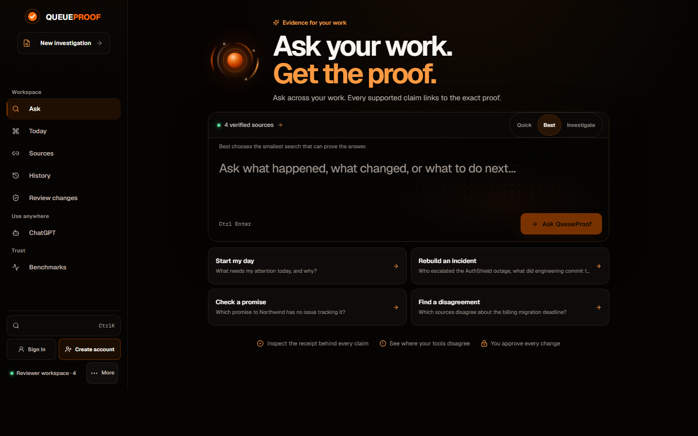
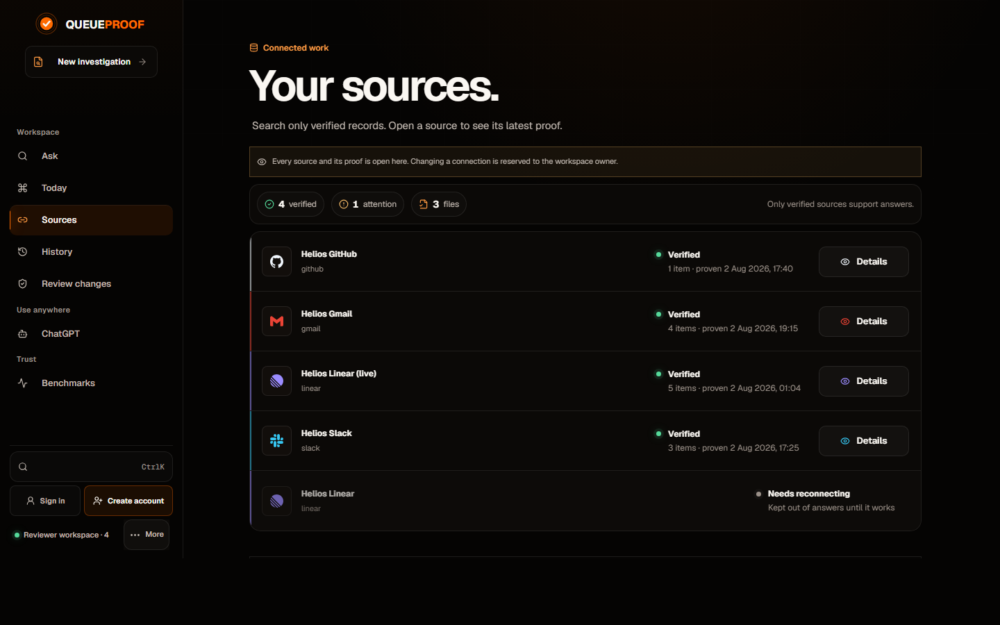
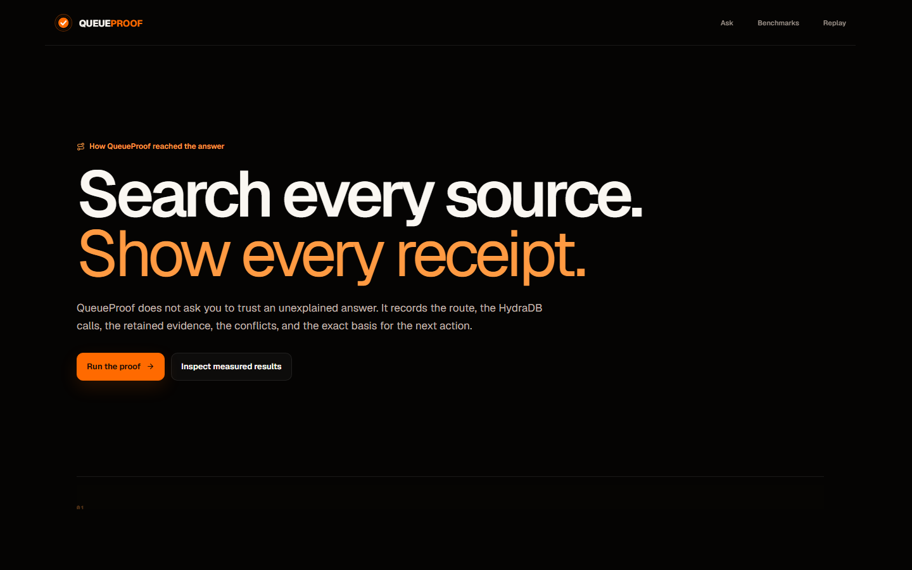
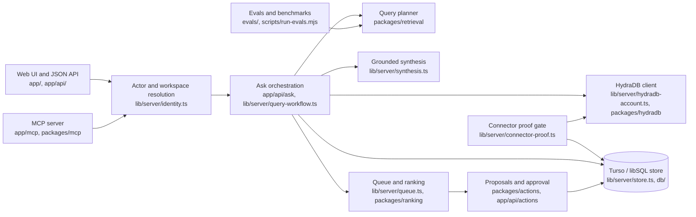

# QueueProof

**Cited answers across your work tools and documents, plus a ranked queue of what needs attention, with every claim linked to the record it came from.**

[](https://github.com/vaibhav4046/queueproof/actions/workflows/ci.yml)

**Live:** <https://queueproof.vercel.app> · **60-second demo:** <https://youtu.be/prKT-PC7NYw> ·
**Method:** <https://queueproof.vercel.app/method>



*Live production homepage (public reviewer workspace), captured 2026-11-21 at 1440x900.*

### What this demonstrates

- **Grounded retrieval that can say "I don't know".** A deterministic query planner
  ([`packages/retrieval`](packages/retrieval/src/index.ts)) routes each question to HydraDB Fast
  or Thinking retrieval (with exact-ID lexical lanes); synthesis
  ([`lib/server/synthesis.ts`](lib/server/synthesis.ts)) ties every claim to a stored receipt and
  returns partial or abstained answers, keeping source contradictions visible instead of merging them.
- **Agent tool access with a human-approval boundary.** An OAuth-protected MCP server
  ([`packages/mcp`](packages/mcp/src/server.ts), [`app/mcp`](app/mcp/route.ts)) exposes scoped
  tools (`queueproof:read`, `propose`, `sync`; no execute tool), plus a public read-only
  `/mcp/demo`. Provider writes start as proposals and need owner approval plus an at-most-once
  execution claim, a `UNIQUE(proposal_id)` row (typed payloads in
  [`packages/actions`](packages/actions/src/index.ts), approval route in
  [`app/api/actions/`](app/api/actions/)).
- **Evals bound to the deployed commit.** A strict grounded grader over frozen fixtures
  ([`evals/`](evals/)), a deterministic router benchmark run in CI, and live benchmark artifacts
  that the product only displays when they match the running release SHA.

QueueProof was built for the HydraDB Connectors Hackathon (July-August 2026). Submission
material lives in [`submission/`](submission/) and [docs/SUBMISSION_COPY.md](docs/SUBMISSION_COPY.md);
release receipts are in [RELEASE_EVIDENCE.md](RELEASE_EVIDENCE.md) and
[docs/MCP_SESSION.md](docs/MCP_SESSION.md).

## The product

Ask one question across the tools a team already uses, and get an answer where every claim
opens to the record it came from.



A source is only allowed into retrieval after HydraDB returns records that are attributable to
its connector lineage. Degraded connectors stay visible and stay out of the denominator.



The evaluation method is published in the product, not just in this repository.



## Product routes

The product has real, shareable routes rather than hash-only panels:

| Route | Purpose |
| --- | --- |
| [`/`](https://queueproof.vercel.app/) | Ask a cited cross-source question |
| [`/queue`](https://queueproof.vercel.app/queue) | **Today** — review the ranked next-action queue |
| [`/evidence`](https://queueproof.vercel.app/evidence) | **Sources** — inspect connector and document receipts |
| [`/benchmarks`](https://queueproof.vercel.app/benchmarks) | **Proof tests** — compare measured retrieval outcomes |
| [`/replay`](https://queueproof.vercel.app/replay) | **History** — revisit questions and replay stored benchmark artifacts |
| [`/approvals`](https://queueproof.vercel.app/approvals) | **Review actions** — inspect proposed writes before execution |
| [`/developer`](https://queueproof.vercel.app/developer) | **Connect AI** — configure MCP clients and inspect the integration contract |
| [`/method`](https://queueproof.vercel.app/method) | Read the evaluation and trust methodology |

Start with **Ask**, open a citation receipt, then inspect the same source under **Sources**.
The **Proof tests** page publishes failures as `REVIEW`; it does not relabel them as passes.

## What is implemented

1. A connector becomes retrieval-eligible only after HydraDB returns attributable records
   and QueueProof stores a proof receipt.
2. The query planner selects fast or thinking retrieval. Identifier-heavy questions can use
   parallel lexical and hybrid lanes before evidence is merged and deduplicated.
3. Answer claims point to stored receipts. Partial answers and abstentions expose what is
   missing, while conflicting source statements remain distinct.
4. Queue items are clustered without merging unrelated exact IDs, then scored by a pure,
   versioned ranking policy.
5. Execution packets carry evidence, constraints, score components, permissions, and a
   receipt hash.
6. Provider writes begin as proposals. Approval and a database-backed at-most-once claim are
   required before execution.

## Results you can reproduce offline

No credentials needed; numbers below are from a clean clone on 2026-11-21.

| Command | Result | What it does and does not show |
| --- | --- | --- |
| `pnpm test` | 654 Vitest tests in 74 files | Deterministic unit and boundary tests (auth, MCP, ranking, synthesis, SSRF, grader). Also run in CI. |
| `pnpm benchmark:router` | Planner picks the labelled Fast/Thinking mode on 42/42 fixture cases (15 categories); 3/3 ranking cases ordered as labelled; 353 fixture assertions pass | Checks the deterministic routing and ranking layer against hand-written labels. It is **not** live retrieval accuracy. |

Live retrieval accuracy, latency, and HydraDB call counts need connected provider data, so they
are measured against the deployment, not in CI (see below).

## Current-release measurements

QueueProof never carries benchmark numbers forward from an older deployment. The running
release identifies itself at [`/api/health/live`](https://queueproof.vercel.app/api/health/live),
and [`/api/lab`](https://queueproof.vercel.app/api/lab) publishes results only when an artifact
is verified against that exact commit SHA.

A result is submission-safe only when all of these are true:

1. `health.release.commitSha` is present and `health.release.target` is `production`.
2. `lab.results.currentRelease.commitSha` equals the health SHA.
3. The relevant result has `status: "measured"`, contains non-empty cases, and identifies the
   same release.
4. Fast versus Thinking is quoted only when `modeComparison.comparable` is `true`.

If a current-release artifact is missing, the product says
`awaiting_current_release_measurement` instead of displaying a historical score. Reviewers
should read exact pass counts, fact recall, latency, calls, and weighted units from
**Proof tests** on the deployed release. `REVIEW` remains a failed strict requirement.

The deterministic router suite is intentionally separate from live retrieval. Weighted units
compare relative query work; they are not dollars. See [connector proof](docs/CONNECTOR_PROOF.md),
[large-PDF proof](docs/LARGE_PDF_PROOF.md), and the
[evaluation methodology](docs/EVALUATION_METHODOLOGY.md).

## Public and owner boundaries

The public deployment is a shared, read-oriented reviewer workspace: visitors can ask bounded,
rate-limited questions, inspect receipts, and review queue packets. Signing in (Supabase magic
link) provisions an isolated private workspace. Credentials, connector changes, uploads,
approvals, MCP administration, and external writes require an authenticated workspace owner,
and public workspace selection fails closed. Details, auth-mode settings, and the provisioning
command: [docs/PUBLIC_AND_OWNER_BOUNDARIES.md](docs/PUBLIC_AND_OWNER_BOUNDARIES.md).

## Architecture



Every request resolves an actor and workspace first, and only connectors that pass the proof
gate are queried. A provider-level data-flow diagram is in
[docs/ARCHITECTURE.md](docs/ARCHITECTURE.md#product-data-flow-diagram).

Evidence flows one way — sources into HydraDB, HydraDB into retrieval, retrieval into cited
claims — and the only path back out to a provider runs through the approval boundary.

| Layer | Responsibility |
| --- | --- |
| Next.js 16 / React 19 | Product shell, API routes, and public/private boundaries |
| HydraDB | Provider catalogue, connector lifecycle, retrieval, and document indexing |
| Turso / libSQL | Durable workspace, receipt, queue, approval, execution, and audit state |
| `packages/retrieval` | Query planning, exact-ID lanes, and evidence normalization |
| `packages/ranking` | Pure, versioned priority scoring and explanations |
| `packages/actions` | Typed provider payloads, risk classification, and execution claims |
| MCP | Scoped agent access to the same workspace-bound product records |

Read [the architecture](docs/ARCHITECTURE.md) and [security model](docs/SECURITY.md) for the
data flow and trust boundaries.

## Run locally

Requirements:

- Node.js 22.13 or newer
- pnpm 10.33.0 (declared in `package.json`)

```bash
corepack enable
pnpm install --frozen-lockfile
```

Copy `.env.example` to `.env.local`. For local-only development, the minimum configuration is:

```dotenv
QUEUEPROOF_ENCRYPTION_KEY=<at-least-32-random-characters>
QUEUEPROOF_ALLOW_LOCAL_IDENTITY=true
QUEUEPROOF_SQLITE_PATH=.data/queueproof.db
QUEUEPROOF_TEST_MODE=false
```

Create the SQLite directory (`node:sqlite` does not create it, and the API returns 500 without
it), then start the development server:

```bash
mkdir -p .data
pnpm dev
```

What works with no external keys: the full UI at <http://localhost:3000>, `/api/health/live`, the
test suite, and `pnpm benchmark:router`. Asking questions, connectors, and the queue need a
HydraDB account added through the Sources UI; until then those API routes answer `409` with the
next setup step. The public read-only MCP demo (`/mcp/demo`) is served by the live deployment.

For hosted storage, set `TURSO_DATABASE_URL` and `TURSO_AUTH_TOKEN` instead of
`QUEUEPROOF_SQLITE_PATH`. Add HydraDB credentials through the private Sources UI; do not commit
them to an environment file. `LINEAR_API_KEY` is optional and must be paired with
`QUEUEPROOF_LINEAR_EXECUTION_WORKSPACE_ID`; the deployment-wide key can execute only for that
exact workspace and only for the stable deployment-owner actor. Supabase personal workspaces never
inherit it. A hosted production multi-user deployment uses `NEXT_PUBLIC_SUPABASE_URL` and
`NEXT_PUBLIC_SUPABASE_PUBLISHABLE_KEY`. With the web-auth selectors omitted, the complete production set resolves to `supabase` and disables legacy
owner sign-in; explicit unsafe production modes are rejected. Setting
`QUEUEPROOF_AUTH_MODE=supabase` and `QUEUEPROOF_LEGACY_OWNER_SIGNIN=false` remains the clearest
operator-visible configuration. Hybrid mode remains available only for deliberate development
migrations. Never commit those values. See
[remote MCP setup](docs/REMOTE_MCP_SETUP.md) for Supabase OAuth-server and ChatGPT setup.
The complete provider configuration is in [Supabase authentication setup](docs/SUPABASE_AUTH_SETUP.md).

## Claude Code plugin

The repository ships a plugin manifest (`.claude-plugin/`) whose MCP server is the public
read-only demo endpoint, so it works with zero credentials:

```bash
claude plugin marketplace add vaibhav4046/queueproof
```

Then inside Claude Code run `/plugin install queueproof@queueproof`. The plugin registers the
`queueproof-demo` HTTP server (`https://queueproof.vercel.app/mcp/demo`), which exposes the
read-only `queueproof_search` tool against the synthetic Helios workspace. It cannot read
personal data, sync connectors, or write anywhere. This is a repository-based install;
QueueProof is not claimed to be listed in any public plugin directory. For a local checkout,
`claude --plugin-dir .` loads the same manifest. Authenticated access to a personal workspace
uses the project MCP configuration in [remote MCP setup](docs/REMOTE_MCP_SETUP.md), not the
plugin.

## Verify

The pull-request CI workflow installs the committed lockfile and runs these deterministic
gates on Node.js 22.13:

```bash
pnpm audit:dependencies
pnpm scan:secrets
pnpm typecheck
pnpm lint
pnpm test
pnpm benchmark:router
pnpm build
pnpm deploy:check
```

`pnpm build` is the exact native Next.js webpack build used by Vercel. The historical
Cloudflare/vinext compatibility build remains available as `pnpm build:cloudflare`; it is not a
substitute for the production gate.

For local shell acceptance, start the built app in one terminal and run the check in another:

```bash
pnpm start
pnpm test:e2e
```

Live benchmarks are deliberately separate from CI because they query connected provider data:

```bash
pnpm benchmark:live -- --url https://queueproof.vercel.app --mode fast
pnpm benchmark:live -- --url https://queueproof.vercel.app --mode thinking
pnpm benchmark:live -- --url https://queueproof.vercel.app --mode auto
pnpm benchmark:pdf -- --url https://queueproof.vercel.app
```

The deterministic router benchmark is not presented as live-retrieval accuracy. Replay frames
are stored artifacts, not newly executed runs. Relative query units are not converted into
invented dollar costs.

## Evidence index

- [Canonical release evidence and sign-off](RELEASE_EVIDENCE.md)
- [Benchmark report](BENCHMARK_REPORT.md)
- [Evaluation methodology](docs/EVALUATION_METHODOLOGY.md)
- [Connector proof](docs/CONNECTOR_PROOF.md)
- [Large-PDF proof](docs/LARGE_PDF_PROOF.md)
- [Security model](docs/SECURITY.md)
- [Historical secret-scan receipt (superseded; CI scans each candidate commit)](audit/secret-scan-2026-08-05.md)
- [Historical dependency receipt (superseded; CI audits the current lockfile)](audit/dependency-audit-2026-08-04.md)
- [Judging matrix](docs/JUDGING_MATRIX.md)
- [Hackathon form answers](docs/HACKATHON_FORM.md)

## Honest boundaries

- Timestamped live results are a small observed sample, not an SLA.
- A `REVIEW` benchmark result is a failed strict requirement, not a partial pass.
- Live and large-document metrics are quoted only when `/api/lab` marks a same-release
  artifact as measured; otherwise the honest result is "awaiting measurement."
- Public users cannot mutate credentials, connectors, uploads, tokens, or external systems.
- A real provider write is proven only by a stored provider response identifier.
- Repository visibility must be verified in a signed-out browser before calling the source
  link public.
- Credentials previously exposed outside this repository must be rotated at their source even
  when repository secret scans are clean.

## License

[MIT](LICENSE)
